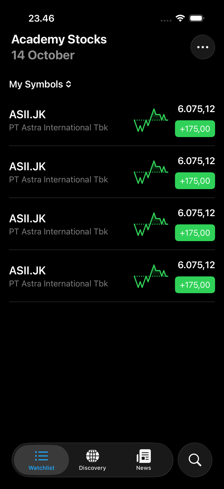
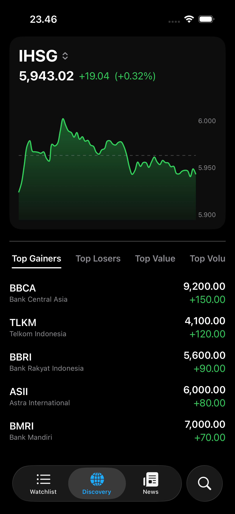
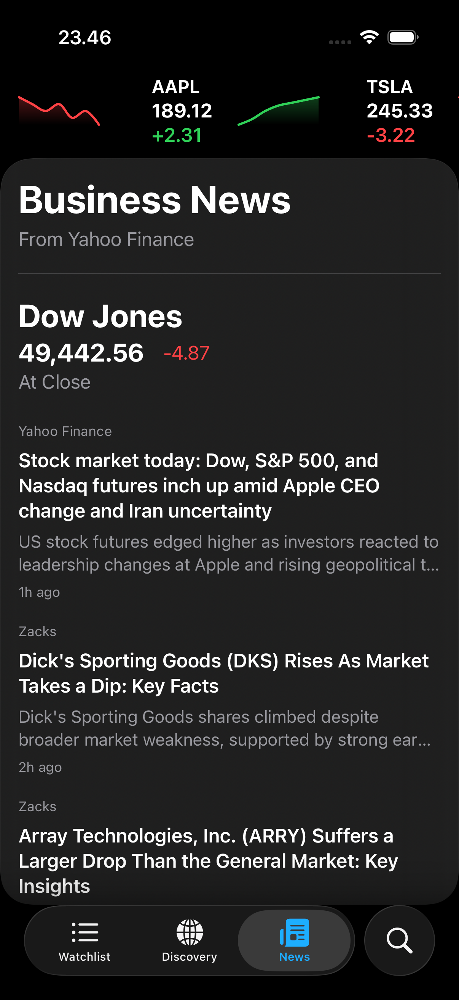

# Academy Stocks

A recreation of Apple's **Stocks** app, remixed for the Indonesian market. Built by a team of two for **Challenge 2 (Recreate and Remix)** at Apple Developer Academy @ BINUS – Bali.

<p align="center">
  
  &nbsp;
  
  &nbsp;
  
</p>

## Recreate

- **Watchlist:** symbols with sparkline charts, price, and daily change, switchable watchlists, and swipe actions
- **Stock detail sheet:** interactive price chart with time ranges from 1D to All, plus key stats
- **Business News:** a scrolling stock ticker, index summary, and news feed
- **Tab bar** with Watchlist, Discovery, News, and Search, using the iOS 26 tab style

## Remix

- **Discovery tab** for the Indonesian market
- **Market switcher** for IHSG, NASDAQ, and S&P 500 with a live index chart
- **Market mover lists:** Top Gainers, Top Losers, Top Value, Top Volume, Top Frequency, Net Foreign Buy, and Net Foreign Sell

> Market charts use live data from Yahoo Finance. The Discovery lists, News feed, and stock stats currently use sample data.

## Tech Stack

- Swift, SwiftUI
- Swift Charts
- Combine
- Yahoo Finance chart API, [XCAStocksAPI](https://github.com/alfianlosari/XCAStocksAPI) (Swift Package)

## Getting Started

Requirements: Xcode 26 or later, iOS 26.2 or later.

1. Clone the repo
   ```bash
   git clone https://github.com/StevanusFelixiano/Recreate-Remake.git
   ```
2. Open `AcademyStocks.xcodeproj` in Xcode (the Swift package resolves automatically)
3. Select an iPhone simulator and press **Run** (⌘R)

## Team

Stevanus · Jarvis
